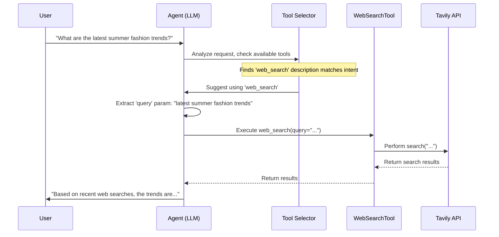

# Chapter 1: Tool Definition & Usage

Welcome to the `shopper-agent` tutorial! Let's start our journey by understanding a fundamental concept: **Tools**.

Imagine you're talking to a shopping assistant chatbot (our `shopper-agent`). You ask it, "What red shoes are available under $50?"

How does the agent find this information? It doesn't magically *know* the store's entire inventory and prices off the top of its head. It needs a way to *look up* this information. That's where **Tools** come in!

Think of the agent as a worker, and **Tools** as the items in its **toolbox**. If the agent needs to look up product information, it uses the "Product Catalog Search" tool. If it needs to add an item to your cart, it uses the "Cart Management" tool. If it needs to search the wider internet for fashion trends, it uses the "Web Search" tool.

In this chapter, we'll learn:

*   What exactly Tools are in `shopper-agent`.
*   Why they are essential for the agent to do useful things.
*   How we define these tools so the agent knows how and when to use them.

## What are Tools, Really?

In the world of agents like `shopper-agent`, **Tools are simply functions that the agent can decide to call to perform specific actions.**

These actions usually involve interacting with something *outside* the agent's brain (the Large Language Model or LLM). This could be:

*   **Searching the web:** Using a search engine like Tavily.
*   **Searching a product database:** Looking for specific items in your store's catalog.
*   **Managing a shopping cart:** Adding items, removing items, checking out.
*   **Calling APIs:** Interacting directly with other software services (like fetching order status, updating customer details, etc.). This is like giving the agent specialized instruments: a "hammer" tool for making `POST` requests (creating or updating data) and a "screwdriver" tool for `GET` requests (fetching data).
*   **Performing calculations:** Although simpler, even a calculator could be a tool.

Without tools, the agent could only chat based on its pre-existing knowledge. With tools, it can access live data, interact with systems, and take real actions on your behalf.

## Defining a Tool: Giving the Agent Instructions

Just like you wouldn't hand someone a complex tool without explaining what it does, we need to define our agent's tools clearly. Each tool definition typically has three main parts:

1.  **Name:** A unique, simple name for the tool (e.g., `web_search`, `searchCatalogTool`, `execGetRequestTool`). This is how the agent identifies the tool.
2.  **Description:** This is **crucial**! The description tells the agent *what the tool does* and *when it should be used*. The agent reads this description to decide if this tool is the right one for the user's current request. Good descriptions are key to a well-functioning agent.
3.  **Input Schema:** This defines *what information the tool needs* to do its job. It specifies the input parameters, their names, their types (like text, number, list), and often a description for each parameter. We use a library called `zod` to define these schemas in `shopper-agent`.

Let's look at a simplified example of the `webSearchTool` defined in `src/tools.ts`:

```typescript
// src/tools.ts (Simplified Example)
import { tool } from '@langchain/core/tools'
import { z } from 'zod'
import { TavilySearchResults } from '@langchain/community/tools/tavily_search'

export const webSearchTool = tool(
  // 1. The actual function code to run
  async ({ query }) => {
    console.log(`web_search executing with query: ${query}`)
    const searchApi = new TavilySearchResults({ maxResults: 2 })
    const results = await searchApi.invoke(query)
    return JSON.stringify(results) // Return results as text
  },
  // 2. The definition object
  {
    name: 'web_search', // The tool's unique name
    description: 'Search the web for the query', // What the tool does
    schema: z.object({ // Defines required inputs
      query: z.string().describe('The query to search the web for') // Needs a 'query' input which must be text
    })
  }
)
```

Let's break down this definition:

1.  **The Function:** The first part (`async ({ query }) => { ... }`) is the actual JavaScript/TypeScript code that runs when the tool is called. It takes an object with a `query` property as input, uses the `TavilySearchResults` tool (from the LangChain library) to perform the web search, and returns the results.
2.  **The Definition Object:**
    *   `name: 'web_search'`: Simple and clear.
    *   `description: 'Search the web for the query'`: Tells the agent: "Use me when you need to search the web."
    *   `schema: z.object({...})`: Uses `zod` to say: "I need exactly one input parameter named `query`, and it must be a string (text). The description helps the agent understand *what* kind of query to provide."

The `tool()` function from LangChain conveniently bundles the function code with its definition (name, description, schema).

## How Does the Agent Use a Tool?

Okay, we have defined tools. How does the agent actually pick one and use it? Here's a typical flow:

1.  **User Request:** The user types something, e.g., "What are the latest summer fashion trends?"
2.  **Agent Analysis:** The agent (the LLM) analyzes the request and understands the user's *intent* (they want up-to-date information from the web).
3.  **Tool Selection:** The agent looks at the list of available tools (like `web_search`, `searchCatalogTool`, etc.) and reads their `description` fields.
4.  **Matching:** It sees that the `web_search` tool's description ("Search the web for the query") perfectly matches the intent.
5.  **Input Extraction:** The agent checks the `schema` for `web_search`. It knows it needs a `query` parameter (a string). It extracts the relevant part from the user's request: "latest summer fashion trends".
6.  **Tool Call:** The agent prepares and executes the call: `web_search({ query: "latest summer fashion trends" })`.
7.  **Tool Execution:** The `web_search` function code runs, calling the Tavily search API.
8.  **Result Return:** The search API returns results, which the `web_search` function sends back to the agent.
9.  **Response Generation:** The agent receives the search results and uses them to formulate a helpful answer for the user.

Here's a simplified diagram of that process:



## Tools in `shopper-agent`

The `shopper-agent` project comes with several pre-defined tools, tailored for e-commerce tasks. You can see them listed in `src/tools.ts`:

```typescript
// src/tools.ts (Snippet)

// Tools available for the Shopper agent
export const SHOPPER_TOOLS_LIST = [
  catalogAPITool, // Tool to figure out how to call the Catalog API
  cartAPITool,    // Tool to figure out how to call the Cart API
  execGetRequestTool, // Tool to execute a GET API request
  execPostRequestTool // Tool to execute a POST API request
]

// Tools available for the Merchandiser agent (different role)
export const MERCHANDISER_TOOLS_LIST = [
  fileAPITool, // Tool for File API info
  pimAPITool,   // Tool for Product Info Management (PIM) API info
  // ... other tools like catalogAdmin, pricebook, etc.
  execGetRequestTool,
  execPostRequestTool,
  execPutRequestTool // Tool to execute a PUT API request
]
```

Notice a few things:

*   Different agent roles (Shopper vs. Merchandiser) can have different tool sets.
*   There are tools like `catalogAPITool` and `cartAPITool`. These are special "planning" tools that first help the agent figure out *which specific API endpoint* to call based on the user's query. We'll explore these more in [Chapter 4: RAG-based API Planning (APITool)](04_rag_based_api_planning__apitool__.md).
*   There are also fundamental tools like `execGetRequestTool`, `execPostRequestTool`, and `execPutRequestTool`. These are the agent's basic "screwdriver," "hammer," and "wrench" for directly interacting with APIs once it knows the specifics (endpoint, parameters).

Let's look at `execGetRequestTool` from `src/utils/apiTools.ts`:

```typescript
// src/utils/apiTools.ts (Simplified Snippet)
import { z } from 'zod'
import { tool } from '@langchain/core/tools'
// ... other imports and helper functions

export const execGetRequestTool = tool(
  // The function to execute a GET request
  async ({ endpoint }, config) => {
    // ... internal logic to get authentication tokens and base URL ...
    console.log(`Executing GET request to: ${endpoint}`);
    // const results = await execGetRequest({ endpoint, ...authOptions })
    // return JSON.stringify(results);
    return `{"message": "Successfully called GET ${endpoint}"}`; // Simplified output
  },
  // The tool definition
  {
    name: 'execGetRequestTool',
    description: 'Execute a GET request to the API', // When to use it
    schema: z.object({ // What input it needs
      endpoint: z.string().describe('The API endpoint to call (e.g., /v2/products)')
    })
  }
)
```

This tool is straightforward:
*   **Name:** `execGetRequestTool`
*   **Description:** Tells the agent to use it when it needs to perform a `GET` request (fetch data).
*   **Schema:** Requires one input, `endpoint`, which is the specific API path to fetch from.

### Schema Validation

Defining the schema with `zod` isn't just for documentation; it's used for **validation**. Before a tool's code is even run, the agent (or the framework) checks if the inputs provided match the schema. This prevents errors caused by missing or incorrect inputs.

Look at this test for `execPostRequestTool` in `test/apiTools.test.ts`:

```typescript
// test/apiTools.test.ts (Snippet)
import { describe, it, expect } from 'vitest'
import { execPostRequestTool } from '../src/utils/apiTools'

// Get the schema definition from the tool
const schema = execPostRequestTool.schema

describe('execPostRequestTool Schema Validation', () => {
  // Test case 1: Correct inputs
  it('should validate correct parameters', () => {
    const validParams = { endpoint: '/test', body: { data: 'value' } }
    // schema.parse tries to validate. No error means success.
    expect(() => schema.parse(validParams)).not.toThrow()
  })

  // Test case 2: Missing 'body' input
  it('should fail validation when body is missing', () => {
    const missingBodyParams = { endpoint: '/test' }
    // schema.parse should throw an error here
    expect(() => schema.parse(missingBodyParams)).toThrow()
  })

  // Test case 3: Empty 'body' (also invalid based on refine rule)
  it('should fail validation when body is empty', () => {
    const emptyBodyParams = { endpoint: '/test', body: {} }
     // schema.parse should throw an error here
    expect(() => schema.parse(emptyBodyParams)).toThrow()
  })
})
```

These tests confirm that our schema definition for `execPostRequestTool` correctly enforces that a non-empty `body` parameter is required for POST requests. This helps ensure the agent uses the tool correctly.

## Conclusion

We've learned that **Tools** are functions that give our `shopper-agent` superpowers! They allow it to interact with the outside world – search the web, query databases, and call APIs.

We define tools with a `name`, a clear `description` (so the agent knows when to use it), and an input `schema` (so the agent knows what information to provide). Libraries like LangChain (`tool()` function) and `zod` help us create and validate these tools.

Now that we understand what tools are and how they're defined, how does the agent actually string together multiple steps and tool calls to handle a complex conversation? That's where the agent's brain and workflow come in.

Let's dive into that next in [Chapter 2: Agent Workflow (LangGraph)](02_agent_workflow__langgraph__.md).

---

Generated by [AI Codebase Knowledge Builder](https://github.com/The-Pocket/Tutorial-Codebase-Knowledge)