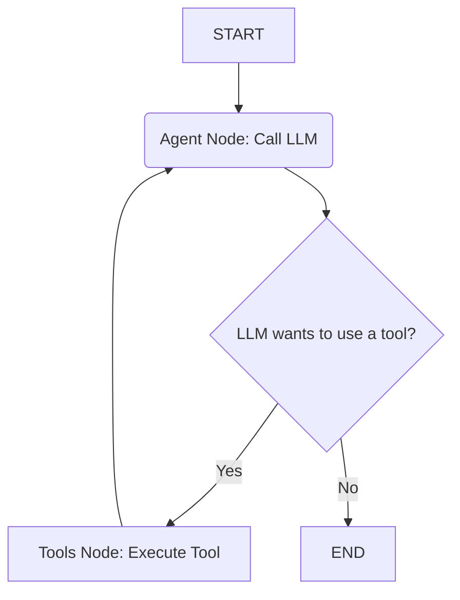

# Chapter 2: Agent Workflow (LangGraph)

In [Chapter 1: Tool Definition & Usage](01_tool_definition___usage_.md), we learned about the individual tools our `shopper-agent` can use, like a toolbox full of specialized instruments (web search, API callers, etc.). That's great, but how does the agent know *when* to use which tool, or *how* to combine multiple steps to answer a complex request?

Imagine asking the agent: "Find me red shoes under $50 and add the cheapest pair to my cart." This requires multiple steps:
1.  Search the product catalog for red shoes under $50.
2.  Analyze the search results to find the cheapest pair.
3.  Add that specific pair to the shopping cart.
4.  Confirm to the user that the item was added.

The agent can't just pick one tool; it needs a plan, a sequence of actions. It needs a **workflow**.

This chapter introduces the agent's "brain" or "director" – the **Agent Workflow**, built using a library called **LangGraph**. Think of LangGraph as a way to draw a flowchart that the agent follows to handle your requests.

## What is LangGraph? The Agent's Flowchart

LangGraph helps us define the agent's process as a **state machine**. Don't worry, that's just a fancy term for a flowchart with states and transitions.

*   **State:** Represents the agent's current situation – what information it has (like the conversation history, the user's latest message, the current shopping cart ID). We'll dive deeper into this in [Chapter 3: State Management](03_state_management_.md).
*   **Nodes:** These are the "boxes" in our flowchart, representing specific actions or steps the agent takes. For example, one node might be "Call the AI Brain (LLM)" and another might be "Use a Tool".
*   **Edges:** These are the "arrows" connecting the boxes, showing the possible paths the agent can take from one step to the next.

Think of it like a simple recipe:

1.  **Start** (Edge) -> **Read User Request** (Node)
2.  **Read User Request** (Node) -> **Decide Next Step** (Node - this is where the AI thinks)
3.  **Decide Next Step** (Node) -> (Conditional Edge)
    *   *If* a tool is needed -> **Use Tool** (Node)
    *   *If* no tool needed -> **Formulate Answer** (Node)
4.  **Use Tool** (Node) -> **Decide Next Step** (Node - go back to thinking with the tool result)
5.  **Formulate Answer** (Node) -> **End** (Edge)

LangGraph allows us to define this logic programmatically.

## The `shopper-agent` Workflow

In `shopper-agent`, our workflow is quite similar to the recipe above. It's defined primarily in `src/indexShopper.ts`. Let's look at the core components:

1.  **`agent` Node:** This node represents the core "thinking" part. It calls the Large Language Model (LLM), giving it the current conversation state and the available tools ([Chapter 1: Tool Definition & Usage](01_tool_definition___usage_.md)). The LLM then decides what to do next: either respond directly to the user or choose a tool to call.
2.  **`tools` Node:** If the `agent` node decides to use a tool, the workflow transitions to this node. The `tools` node is responsible for actually executing the specific tool function (like `searchCatalogTool` or `execGetRequestTool`) with the inputs provided by the LLM.
3.  **Conditional Edge (`shouldContinue`)**: After the `agent` node runs, we need a decision point. Does the LLM want to use a tool? Or is it ready to give a final answer? This edge checks the LLM's output. If the LLM included a "tool call" in its response, we go to the `tools` node. Otherwise, the conversation might end (or proceed differently, though in our simple case, it often ends).

Here's a simplified view of the workflow using a diagram:



This diagram shows:
*   We start (`A`) and go to the `agent` node (`B`).
*   The `agent` node decides (`C`).
*   If a tool is needed (`Yes`), we go to the `tools` node (`D`), which then goes back to the `agent` node (`B`) with the tool's result.
*   If no tool is needed (`No`), the process ends (`E`).

## Defining the Workflow in Code

Let's peek at how this flowchart is defined in `src/indexShopper.ts` using LangGraph's `StateGraph`.

```typescript
// src/indexShopper.ts (Simplified)
import { ToolNode } from '@langchain/langgraph/prebuilt'
import { END, START, StateGraph } from '@langchain/langgraph'
import { callModel } from './agentLogic' // Simplified import name
import { shouldContinue } from './conditionalLogic' // Simplified import name
import { ShopperStateSchema, ShopperConfigSchema } from './types/shopper-schemas'
import { SHOPPER_TOOLS_LIST } from './tools'

// 1. Define the structure of our agent's memory (State)
const workflow = new StateGraph(ShopperStateSchema, ShopperConfigSchema);

// 2. Create the node that runs the tools
const toolNode = new ToolNode(SHOPPER_TOOLS_LIST);

// 3. Add the main "thinking" node (calls the LLM)
workflow.addNode('agent', callModel);

// 4. Add the node for executing tools
workflow.addNode('tools', toolNode);

// 5. Define the starting point
workflow.addEdge(START, 'agent');

// 6. Define the decision point after the agent thinks
workflow.addConditionalEdges(
  'agent', // Source node
  shouldContinue, // Function to decide where to go next
  { // Possible destinations
    tools: 'tools', // If shouldContinue returns 'tools', go to 'tools' node
    __end__: END // If shouldContinue returns END, finish the flow
  }
);

// 7. Define the path *after* a tool is executed
workflow.addEdge('tools', 'agent'); // Go back to the agent to process tool results

// 8. Compile the workflow into a runnable graph
export const graph = workflow.compile();
```

Let's break this down step-by-step:

1.  **`new StateGraph(...)`**: We initialize our flowchart, telling it what kind of information (State) it will manage. More on state in [Chapter 3: State Management](03_state_management_.md).
2.  **`new ToolNode(...)`**: LangGraph provides a convenient `ToolNode` that knows how to execute any tool from the list we provide (`SHOPPER_TOOLS_LIST` from [Chapter 1: Tool Definition & Usage](01_tool_definition___usage_.md)).
3.  **`workflow.addNode('agent', callModel)`**: We add our first main box, named `agent`. When the workflow reaches this node, it will run the `callModel` function (which we'll simplify below).
4.  **`workflow.addNode('tools', toolNode)`**: We add the second box, named `tools`, using the pre-built `toolNode`.
5.  **`workflow.addEdge(START, 'agent')`**: We draw the first arrow: from the special `START` point directly to our `agent` node. Every request starts here.
6.  **`workflow.addConditionalEdges(...)`**: This is the crucial decision arrow. After the `agent` node runs, it calls the `shouldContinue` function. Based on the return value of `shouldContinue` ('tools' or `END`), the workflow moves to the `tools` node or finishes.
7.  **`workflow.addEdge('tools', 'agent')`**: We draw the arrow from the `tools` node *back* to the `agent` node. This creates the loop: think -> use tool -> think again with results.
8.  **`workflow.compile()`**: This takes our defined flowchart and makes it ready to process requests.

### The `callModel` Node (Simplified)

The `callModel` function is the heart of the `agent` node. Its main job is to interact with the LLM.

```typescript
// src/indexShopper.ts -> callModel (Simplified Concept)
import { ChatOpenAI } from '@langchain/openai'
import { SHOPPER_TOOLS_LIST } from './tools'
import { ShopperState } from './types/shopper-schemas'

const llm = new ChatOpenAI({ model: 'gpt-4o', temperature: 0 });

// This function IS the 'agent' node
async function callModel(state: ShopperState) {
  const { messages } = state; // Get current conversation messages

  // Prepare the LLM to be able to use our tools
  const llmWithTools = llm.bindTools(SHOPPER_TOOLS_LIST);

  // Ask the LLM what to do next based on the conversation
  console.log("Agent node: Asking LLM what to do...");
  const response = await llmWithTools.invoke(messages);
  console.log("Agent node: LLM responded.");

  // Return the LLM's response to update the state
  return {
    messages: response // Add LLM's response to the message list
  };
}
```

This simplified version shows:
*   It receives the current `state` (including messages).
*   It uses an LLM (`ChatOpenAI`) that has been made aware of the available `SHOPPER_TOOLS_LIST`.
*   It sends the current messages to the LLM using `invoke`.
*   It returns the LLM's `response` (which might be a simple text answer or a request to use a tool).

### The `shouldContinue` Conditional Edge (Simplified)

This function checks the LLM's *last* response (which `callModel` just added to the state) to decide where to go next.

```typescript
// src/indexShopper.ts -> shouldContinue (Simplified Concept)
import { END } from '@langchain/langgraph';
import { AIMessage } from '@langchain/core/messages';
import { ShopperState } from './types/shopper-schemas';

// This function IS the conditional edge logic
function shouldContinue(state: ShopperState): 'tools' | typeof END {
  const { messages } = state;
  const lastMessage = messages[messages.length - 1];

  // Check if the last message is from the AI and has tool calls
  if (
    lastMessage instanceof AIMessage &&
    lastMessage.tool_calls &&
    lastMessage.tool_calls.length > 0
  ) {
    // Yes, LLM wants to use a tool
    console.log("Decision: LLM wants to use a tool. Routing to 'tools' node.");
    return 'tools';
  } else {
    // No tool calls, the LLM gave a final answer (or thinks it did)
    console.log("Decision: No tool calls from LLM. Routing to END.");
    return END;
  }
}
```

This logic is simple:
*   Look at the very last message in the conversation.
*   Is it an AI message containing instructions to call one or more tools (`tool_calls`)?
*   If YES, return the string `'tools'`, telling the `StateGraph` to go to the node named `tools`.
*   If NO, return the special `END` value, telling the `StateGraph` to stop here.

## Putting It All Together

When a user sends a message like "What red shoes are under $50?":

1.  The message is added to the initial `state`.
2.  The `graph` (our compiled workflow) starts.
3.  **`START` -> `agent`**: The `callModel` function runs. It sends the message to the LLM.
4.  The LLM analyzes the request and sees it needs to search the catalog. It responds with a message saying "Okay, I'll search" AND includes a `tool_call` instruction like `searchCatalogTool({ color: "red", max_price: 50 })`.
5.  **`agent` -> `shouldContinue`**: The `shouldContinue` function checks the LLM's response. It finds the `tool_calls`.
6.  **`shouldContinue` returns `'tools'` -> `tools`**: The workflow moves to the `tools` node.
7.  **`tools` node**: The `ToolNode` sees the `searchCatalogTool` request and executes the corresponding tool function from `SHOPPER_TOOLS_LIST` (like we defined in Chapter 1). Let's say the tool finds two pairs of shoes.
8.  **`tools` -> `agent`**: The result of the tool (the list of two shoes) is added to the conversation state, and the workflow goes back to the `agent` node.
9.  **`agent` node**: `callModel` runs again. This time, the LLM receives the original request *and* the results from the tool. The LLM now knows the shoes. It formulates a response like "I found two pairs: [Shoe A details], [Shoe B details]." This time, it does *not* include any `tool_calls`.
10. **`agent` -> `shouldContinue`**: `shouldContinue` checks the new response. No `tool_calls` are found.
11. **`shouldContinue` returns `END` -> `END`**: The workflow finishes, and the final response ("I found two pairs...") is sent to the user.

This loop (`agent` -> `tools` -> `agent`) allows the agent to perform multiple actions, using tools as needed, until the user's request is fully addressed.

## Conclusion

The **Agent Workflow**, defined using **LangGraph**, acts as the central control system or "brain" for `shopper-agent`. It uses a state machine (flowchart) approach with nodes (`agent`, `tools`) and edges (including conditional ones like `shouldContinue`) to manage the sequence of operations. This allows the agent to understand requests, decide whether to use a tool from its toolbox ([Chapter 1: Tool Definition & Usage](01_tool_definition___usage_.md)), execute it, process the results, and continue the cycle until it can provide a final answer.

But how does the workflow keep track of the conversation history, the cart ID, and other pieces of information as it moves between nodes? That's where state management comes in.

Let's explore that in the next chapter: [Chapter 3: State Management](03_state_management_.md).

---

Generated by [AI Codebase Knowledge Builder](https://github.com/The-Pocket/Tutorial-Codebase-Knowledge)