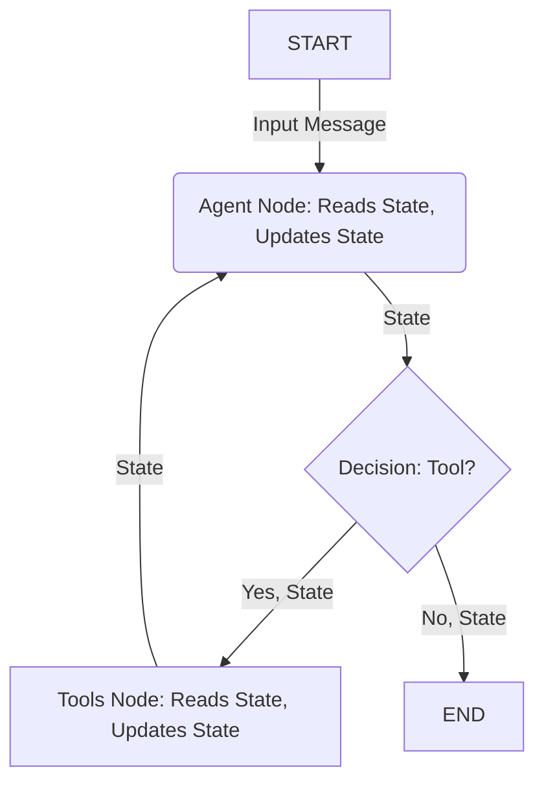

# Chapter 3: State Management

In [Chapter 2: Agent Workflow (LangGraph)](02_agent_workflow__langgraph__.md), we saw how our `shopper-agent` uses a flowchart (a LangGraph workflow) to decide what steps to take – like calling the AI brain or using a tool. But how does the agent remember what happened in previous steps or even earlier in the conversation? Imagine this:

1.  **You:** "Show me some red shoes."
2.  **Agent:** (Uses a tool, finds shoes) "Okay, I found Shoe A ($45) and Shoe B ($60)."
3.  **You:** "Add the cheaper one to my cart."

How does the agent know which shoe is "the cheaper one"? It needs to *remember* the results from step 2. It also needs to remember which shopping cart belongs to *you*. This ability to remember is called **State Management**.

Think of the **State** as the agent's **short-term memory** or a **notepad** it carries around while working on your request. As it moves through the steps in its workflow, it reads from and writes to this notepad.

## What's on the Agent's Notepad (State)?

The "State" in `shopper-agent` is a collection of important pieces of information that need to be tracked during the conversation. Let's look at the key items:

1.  **`messages`**: This is the most detailed record of the conversation. It's a list containing every message exchanged:
    *   Your messages (Human messages)
    *   The agent's text responses (AI messages)
    *   Instructions from the agent to use a tool (AI tool calls)
    *   The results returned by the tools (Tool messages)
    This full history gives the agent the complete context when deciding what to do next.

2.  **`conversationHistory`**: This is a *simplified*, text-only summary of the recent conversation, like "User: Show me red shoes.\nAssistant: Okay, I found Shoe A ($45)...". It's mainly used to give the AI (LLM) a quick reminder of the recent back-and-forth without overwhelming it with too much detail. It's also kept to a limited size to prevent it from getting too long.

3.  **`cartId`**: Imagine a busy store with many shoppers. The agent needs to know which shopping cart is yours! This `cartId` is a unique identifier for your current shopping session. When you ask to add an item, the agent uses this ID to put it in the correct cart. If you don't have one yet, the agent creates a new one for you.

4.  **`lastActionSuccess`**: Did the last thing the agent tried to do (like calling an API tool) actually work? This field stores a simple `true` (it worked) or `false` (it failed). This helps the agent understand if it should continue building on the previous step or if it needs to backtrack or try something else. It's like the agent checking, "Okay, did adding that item *actually* succeed before I tell the user it did?"

## How the Workflow Uses State

Remember the LangGraph workflow from [Chapter 2: Agent Workflow (LangGraph)](02_agent_workflow__langgraph__.md)? It has nodes (like `agent` and `tools`) and edges connecting them. The **State** is the information that gets passed along these connections from one node to the next.



As you can see:
*   The initial message starts the process, forming the initial State.
*   The `agent` node **reads** the current State (messages, cartId, etc.) to understand the context. Then, it **updates** the State (e.g., adds its own response to `messages`, updates `conversationHistory`, maybe generates a `cartId`).
*   If a tool is needed, the updated State is passed to the `tools` node.
*   The `tools` node **reads** the State (e.g., gets the `cartId` if needed for a cart operation) and **updates** the State (specifically, it sets `lastActionSuccess` based on whether the tool worked).
*   The State (now including the tool result and `lastActionSuccess`) is passed back to the `agent` node for the next round of thinking.

This continuous passing and updating of the State ensures that every part of the workflow has the necessary context and that information isn't lost between steps.

## Defining the State's Structure

How do we tell LangGraph what our notepad (State) looks like? We define a "schema" – a blueprint for the state object. In `shopper-agent`, this is done in `src/types/shopper-schemas.ts`.

```typescript
// src/types/shopper-schemas.ts (Simplified)
import { Annotation, MessagesAnnotation } from '@langchain/langgraph'

// Define the blueprint for our agent's memory (State)
export const ShopperStateSchema = Annotation.Root({
  // Includes the standard 'messages' field from LangGraph
  ...MessagesAnnotation.spec,

  // Our custom fields:
  cartId: Annotation<string | undefined>, // Can be text or not set yet
  conversationHistory: Annotation<string[]>, // A list of text summaries
  lastActionSuccess: Annotation<boolean | undefined> // True, false, or not set yet
})

// Define the type based on the schema for use in code
export type ShopperState = typeof ShopperStateSchema.State
```

Let's break this down:
*   `Annotation.Root({...})`: This is how LangGraph defines the overall structure.
*   `...MessagesAnnotation.spec`: This is a shortcut to include the standard `messages` field that LangGraph expects for conversation history.
*   `cartId: Annotation<string | undefined>`: Defines `cartId`. It's expected to be `string` (text), but it might be `undefined` initially.
*   `conversationHistory: Annotation<string[]>`: Defines `conversationHistory` as an array (`[]`) of `string`s.
*   `lastActionSuccess: Annotation<boolean | undefined>`: Defines `lastActionSuccess` as a `boolean` (`true`/`false`), or `undefined` if no action has been checked yet.
*   `export type ShopperState = ...`: This creates a TypeScript type based on our schema, making it easier to work with the state object in our code.

## How is the State Updated in Code?

Different parts of the workflow update different parts of the state.

### 1. The `agent` Node (`callModel` function)

The main "thinking" node (`callModel` in `src/indexShopper.ts`) is responsible for updating the conversational parts of the state after the LLM responds.

```typescript
// src/indexShopper.ts (Simplified callModel return)

async function callModel(state: ShopperState) {
  // ... (LLM call logic happens here) ...
  const llmResult = await llmWithTools.invoke(...) // Get LLM response
  const currentCartId = state.cartId || uuidv4() // Get existing or create new cart ID
  const updatedHistory = [...state.conversationHistory] // Copy existing history
  // ... (add latest user message and LLM response to updatedHistory) ...
  // ... (limit history size) ...

  // Return the *new* state values
  return {
    messages: llmResult, // Add the LLM's latest message/tool_call
    cartId: currentCartId, // Ensure cartId is set
    conversationHistory: updatedHistory, // The updated summary
    lastActionSuccess: undefined // Reset this before the next action
  }
}
```

This code shows that after the LLM call, `callModel` returns an object containing the *new* values for `messages`, `cartId`, `conversationHistory`, and it resets `lastActionSuccess` to `undefined` because we don't yet know if the *next* action (if any) will succeed. LangGraph automatically merges these updates into the main state object.

### 2. The `tools` Node & API Calls (`execRequests`)

When a tool, especially one that calls an external API (like searching products or modifying the cart), is executed, we need to know if it succeeded. This happens within the tool execution logic itself, often in helper functions like `execGetRequest` found in `src/lib/execRequests.ts`.

Because tools might be executed *outside* the direct LangGraph node functions, `shopper-agent` uses a simple mechanism: the `callModel` function stores the *current* state in a globally accessible variable (`global.lastShopperState`) just before it runs. The API execution functions can then access this global variable to update `lastActionSuccess`.

```typescript
// src/lib/execRequests.ts (Simplified execGetRequest)

export async function execGetRequest({ endpoint, token }: ...) {
  try {
    // ... (prepare and make the actual API GET request) ...
    const response = await fetch(url, { /* ... */ });
    const data = await response.json();

    // Check if the API call was successful (e.g., status 200 OK)
    const success = response.ok;

    // Update the globally stored state if available
    if (global.lastShopperState) {
      global.lastShopperState.lastActionSuccess = success;
      console.log(`Updated lastActionSuccess to: ${success}`);
    }

    // Return the result along with success status
    return { success, status: response.status, data };

  } catch (error) {
    // If any error happens during the request...
    if (global.lastShopperState) {
      global.lastShopperState.lastActionSuccess = false; // Mark as failed
      console.log(`Updated lastActionSuccess to: false due to error`);
    }
    return { success: false, error: `${error}` };
  }
}
```

Here, after the `fetch` call:
1.  We check if the response was `ok` (HTTP status 200-299).
2.  We access `global.lastShopperState` (which `callModel` set earlier) and update its `lastActionSuccess` field to `true` or `false`.
3.  If an error occurs, we explicitly set `lastActionSuccess` to `false`.

This ensures that after the `tools` node finishes, the state passed back to the `agent` node accurately reflects whether the attempted action succeeded or failed.

### 3. Keeping History Tidy (`conversationHistory`)

As the conversation gets longer, the `conversationHistory` could become huge! To keep things efficient, the `callModel` function also trims this history, keeping only the most recent exchanges.

```typescript
// src/indexShopper.ts (Simplified history trimming in callModel)

// ... inside callModel, after adding latest messages to updatedHistory ...
if (updatedHistory.length > 20) { // If history has more than 20 entries (10 exchanges)
  const excessEntries = updatedHistory.length - 20;
  updatedHistory.splice(0, excessEntries); // Remove the oldest entries
  console.log(`Trimmed conversationHistory to ${updatedHistory.length} entries.`);
}
// ... return { ..., conversationHistory: updatedHistory, ... }
```
This prevents the state from growing indefinitely and keeps the context passed to the LLM focused on the most relevant recent interactions. You can see tests for this logic in `test/conversation-context.test.ts`.

## Conclusion

State Management is the agent's memory. It's how `shopper-agent` keeps track of the ongoing conversation (`messages`, `conversationHistory`), essential details like the `cartId`, and feedback on recent actions (`lastActionSuccess`).

We define the structure of this memory using a `StateSchema` and LangGraph passes this state object through the workflow nodes (`agent`, `tools`). Each node reads the current state and updates it as needed, ensuring context is maintained throughout complex interactions. Key functions like `callModel` update conversational state, while tool execution logic updates action success status.

Now that we understand the agent's tools ([Chapter 1: Tool Definition & Usage](01_tool_definition___usage_.md)), its workflow ([Chapter 2: Agent Workflow (LangGraph)](02_agent_workflow__langgraph__.md)), and its memory (this chapter), how does the agent *intelligently* figure out which specific API tool or endpoint to use for tasks like "find red shoes"? That involves a technique called Retrieval-Augmented Generation (RAG).

Let's explore that in the next chapter: [Chapter 4: RAG-based API Planning (APITool)](04_rag_based_api_planning__apitool__.md).

---

Generated by [AI Codebase Knowledge Builder](https://github.com/The-Pocket/Tutorial-Codebase-Knowledge)