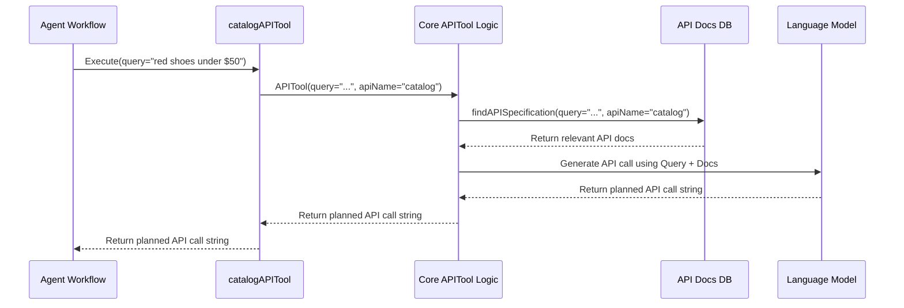

# Chapter 4: RAG-based API Planning (APITool)

In the previous chapter, [Chapter 3: State Management](03_state_management_.md), we learned how our `shopper-agent` keeps track of the conversation using its "notepad" or State. This memory helps it remember things like your shopping cart ID and the recent messages.

But how does the agent take a simple request like "Find me red shoes under $50" and figure out the *exact*, highly specific command it needs to send to the store's computer system (the API)? It can't just guess! It needs a way to translate your everyday language into the precise language of the API.

This is where **RAG-based API Planning** comes in, powered by a special tool we call the **APITool**.

## The Challenge: From Chat to Code

Imagine you're telling a librarian, "I need instructions on how to build a birdhouse." The librarian doesn't just hand you a random book. They first *understand* your request ("build a birdhouse"), then *find* the right instruction manuals (books on woodworking, specifically birdhouses), and finally *read* those manuals to tell you the exact steps ("Step 1: Get wood, Step 2: Cut pieces...").

Our agent faces a similar challenge. When you say "find red shoes under $50", the agent needs to:
1.  **Understand:** You want to search the product catalog.
2.  **Find:** Locate the specific instructions (API documentation) for searching products, filtering by color ('red'), and filtering by price ('under $50').
3.  **Plan:** Read those instructions to figure out the exact API command, like `GET /catalog/products?filter=eq(color,red)&filter=lt(price,50)`.

The **APITool** is our agent's skilled librarian, designed specifically for API instructions.

## What is RAG? The Librarian's Strategy

APITool uses a smart technique called **RAG**, which stands for **Retrieval-Augmented Generation**. It sounds fancy, but it's quite logical:

1.  **Retrieval:** This is the "finding" part. Based on your request ("red shoes under $50"), the APITool first *retrieves* relevant snippets of API documentation from a specialized database (we use MongoDB for this, which we'll explore in [Chapter 6: Data Retrieval (MongoDB)](06_data_retrieval__mongodb_.md)). It looks for docs about product searching, color filters, price filters, etc. Think of this as the librarian finding the right pages in the instruction manuals.

2.  **Augmented:** This means "adding to" or "enhancing". The APITool takes your original request and *adds* the helpful API documentation snippets it just found. It prepares a package of information for the agent's "brain" (the Large Language Model or LLM).

3.  **Generation:** This is the "planning" or "reading carefully" part. The LLM receives your request *augmented* with the relevant API docs. With this combined information, the powerful LLM can now *generate* the precise API call needed, including the correct endpoint (like `/catalog/products`) and parameters (like `filter=eq(color,red)`).

So, RAG = Find relevant info + Add it to the question + Generate a detailed answer based on everything.

## The APITool: Our RAG Specialist

In `shopper-agent`, the **APITool** is the function that puts the RAG strategy into action for API planning. It's not just one tool, but a *type* of tool. We have specific instances for different parts of the e-commerce system:

*   `catalogAPITool`: Handles requests related to searching or viewing products.
*   `cartAPITool`: Handles requests for adding items to the cart, viewing the cart, etc.
*   `pimAPITool`: Used by the Merchandiser agent for managing product details (not typically used by shoppers).
*   ... and others for files, pricebooks, etc.

These are all defined as Tools ([Chapter 1: Tool Definition & Usage](01_tool_definition___usage_.md)) so the agent's workflow ([Chapter 2: Agent Workflow (LangGraph)](02_agent_workflow__langgraph__.md)) can choose the right one based on your request.

Let's look at the definition of `catalogAPITool` in `src/tools.ts`:

```typescript
// src/tools.ts (Simplified Snippet)
import { z } from 'zod'
import { tool } from '@langchain/core/tools'
import { APITool } from './utils/ragTools' // The core RAG logic

export const catalogAPITool = tool(
  // The function that runs when this tool is called
  async ({ query }: { query: string }) => {
    // It calls the main APITool logic for the 'catalog' API area
    return await APITool(query, 'catalog')
  },
  // The tool's definition for the agent
  {
    name: 'catalogAPITool',
    description: 'Information about the catalog API, searching products...', // Helps agent choose
    schema: z.object({ // Defines required input
      query: z.string().describe('The user query to match the API specification')
    })
  }
)
```

This definition tells the agent:
*   **Name:** `catalogAPITool`
*   **Description:** Use this tool when the user asks about searching or getting info from the product catalog.
*   **Schema:** This tool needs the user's `query` (like "red shoes under $50") as input.
*   **Action:** When called, it runs the core `APITool` function, telling it to focus on the `catalog` API documentation.

## How APITool Works: Under the Hood

Let's trace what happens when the agent decides to use `catalogAPITool` for the query "Show me red shoes under $50":

1.  **Agent Selects Tool:** The agent's workflow determines that `catalogAPITool` is the best fit based on its description.
2.  **Tool Called:** The workflow executes `catalogAPITool` with the input `query: "Show me red shoes under $50"`.
3.  **APITool Starts:** The main `APITool` function (`src/utils/ragTools.ts`) receives the query and the API name (`catalog`).
4.  **Retrieve:** `APITool` calls `findAPISpecification` (`src/lib/mongoDBRetriever.ts`). This function searches the MongoDB database (see [Chapter 6: Data Retrieval (MongoDB)](06_data_retrieval__mongodb_.md)) for API docs related to "catalog", "shoes", "red", "price", "filter", etc. It finds relevant snippets describing the product search endpoint and its filtering parameters.
5.  **Augment:** `APITool` prepares a detailed prompt for the LLM. This prompt includes:
    *   System instructions: "You are an API execution planner..."
    *   The user's query: "Show me red shoes under $50"
    *   Maybe some conversation history from the State ([Chapter 3: State Management](03_state_management_.md)) for context.
    *   The **retrieved API documentation snippets**.
6.  **Generate:** `APITool` sends this augmented prompt to the LLM.
7.  **LLM Plans:** The LLM analyzes the query and the provided API docs. It figures out the exact method (`GET`), endpoint (`/catalog/products`), and query parameters (`?filter=eq(color,red)&filter=lt(price,50)`).
8.  **Result Returned:** The LLM sends the planned API call string back to `APITool`.
9.  **Tool Finishes:** `APITool` returns the generated API call string (`GET /catalog/products?filter=eq(color,red)&filter=lt(price,50)`) to the agent's workflow.
10. **Next Step:** The workflow now has a precise plan. It will likely pass this plan to an execution tool (like `execGetRequestTool` from [Chapter 7: API Execution Tools](07_api_execution_tools_.md)) to actually make the API call.

Here’s a simplified diagram of that flow:



## Diving into the Code (Simplified)

Let's look at the core `APITool` function in `src/utils/ragTools.ts` where the RAG magic happens:

```typescript
// src/utils/ragTools.ts (Simplified APITool function)
import { findAPISpecification } from 'lib/mongoDBRetriever' // Step 4: Retrieve
import { ChatOpenAI } from '@langchain/openai' // The LLM

// The main function implementing RAG for API planning
export async function APITool(
  query: string, // User's request (e.g., "red shoes under $50")
  apiName: string, // API area (e.g., "catalog")
  conversationHistory: string[] = [] // Optional context
) {
  const llm = new ChatOpenAI({ /* ... config ... */ }); // Initialize the LLM brain

  // --- Step 4: RETRIEVAL ---
  // Find relevant API docs from MongoDB
  const specResults = await findAPISpecification(query, apiName);
  // Extract the text content from the results
  const context = specResults.map((doc) => doc.pageContent).join('\n\n');

  // --- Step 5: AUGMENTATION ---
  // Prepare the prompt for the LLM
  const systemMessage = { /* ... instructions for LLM ... */ };
  // Add the retrieved docs and query to the instructions
  systemMessage.content += `\n User query: ${query}\n Available OpenAPI specs:\n ${context}`;
  // Add history if available
  // ... logic to add conversationHistory ...

  // --- Step 6 & 7: GENERATION & PLANNING ---
  // Ask the LLM to generate the API plan
  console.log("APITool: Asking LLM to plan API call...");
  const result = await llm.invoke([systemMessage]);
  console.log("APITool: LLM generated plan:", result.content);

  // --- Step 8: RETURN RESULT ---
  return result.content; // Return the generated API call string
}
```

Breaking it down:
1.  **`findAPISpecification(query, apiName)`**: This performs the **Retrieval** step, querying MongoDB for relevant API documentation based on the user's query and the target API (`catalog`, `cart`, etc.). This connects to concepts in [Chapter 6: Data Retrieval (MongoDB)](06_data_retrieval__mongodb_.md).
2.  **`context = ...`**: We extract the actual text from the retrieved documents.
3.  **`systemMessage`**: We build the detailed prompt for the LLM, combining instructions, the user query, and the retrieved `context`. This is the **Augmentation**.
4.  **`llm.invoke([systemMessage])`**: We send the augmented prompt to the LLM to perform the **Generation** step, asking it to create the API plan.
5.  **`return result.content`**: We return the LLM's generated plan (the API call string).

This RAG process allows the agent to dynamically figure out complex API calls based on your natural language requests and the available API documentation, without needing pre-programmed logic for every possible query.

## Conclusion

We've learned about the powerful **RAG (Retrieval-Augmented Generation)** technique and how the **APITool** uses it to act like a skilled librarian for our agent. By **Retrieving** relevant API documentation, **Augmenting** the user's query with this information, and having an LLM **Generate** a plan, the agent can translate natural language into precise API calls.

This mechanism is central to how `shopper-agent` understands and interacts with backend systems. It allows the agent to intelligently use tools like `catalogAPITool` or `cartAPITool` to plan actions based on your needs.

But how does the agent (and the underlying RAG process) understand the *structure* and *rules* of these APIs in the first place? The API documentation we retrieve often follows a standard format called the OpenAPI Specification. Let's explore how the agent interacts with these specifications next.

Continue to [Chapter 5: OpenAPI Specification Interaction](05_openapi_specification_interaction_.md).

---

Generated by [AI Codebase Knowledge Builder](https://github.com/The-Pocket/Tutorial-Codebase-Knowledge)