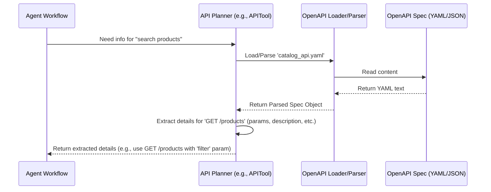

# Chapter 5: OpenAPI Specification Interaction

In [Chapter 4: RAG-based API Planning (APITool)](04_rag_based_api_planning__apitool__.md), we saw how the `shopper-agent` uses a clever technique (RAG) to find relevant API documentation and plan which API call to make. For instance, it figured out it needed to use something like `GET /catalog/products?filter=eq(color,red)&filter=lt(price,50)`.

But how does the agent *know* the exact format for that `filter` parameter? How does it know if `color` and `price` are valid things to filter by? How does it know it should use `GET` and not `POST`?

The agent needs the API's official **rulebook** or **instruction manual**. This manual is typically written in a standard format called the **OpenAPI Specification**, and this chapter explains how our agent reads and understands this manual.

## What is an API's "Instruction Manual"? (OpenAPI)

Imagine getting a new gadget. It comes with a manual explaining what each button does, what inputs it needs (like batteries), and what to expect when you use it. An **OpenAPI Specification** (often written in a file format called YAML or JSON) is exactly that – a detailed manual for a software API.

It precisely describes things like:

*   **Available Endpoints (`paths`):** What specific "addresses" can the agent contact? (e.g., `/products`, `/cart/{cartId}/items`)
*   **Allowed Actions (`methods`):** What can the agent *do* at each address? (`GET` to fetch data, `POST` to create data, `PUT` to update, `DELETE` to remove).
*   **Required Ingredients (`parameters`):** What information does the agent *need* to provide when contacting an endpoint? (e.g., for `/products`, maybe a `filter` parameter; for `/cart/{cartId}/items`, the `cartId` is needed in the path).
*   **Data Format (`schemas`):** What should the data look like when the agent sends it (request body) or receives it (response body)? (e.g., "send product ID and quantity as a JSON object").
*   **Descriptions:** Plain English explanations of what each part of the API does.

Here's a tiny peek at what a piece of an OpenAPI spec might look like in YAML format:

```yaml
# Simplified OpenAPI Snippet (YAML)
paths:
  /products: # The endpoint address
    get: # The allowed action (HTTP GET method)
      summary: Search for products # Short description
      description: Retrieves a list of products based on filter criteria. # Detailed description
      parameters: # List of required inputs
        - name: filter # Parameter name
          in: query # Where it goes (in the URL query string)
          description: Filter criteria (e.g., eq(color,red)) # Explanation
          required: false # Is it mandatory?
          schema: # What type of data is it?
            type: string
      responses: # What to expect back
        '200': # Status code 200 means 'OK'
          description: A list of products.
          content:
            application/json: # Response data is in JSON format
              schema:
                type: array # It's a list...
                items: # ...of product objects
                  $ref: '#/components/schemas/Product' # Defined elsewhere
  # ... other paths and components ...
components:
  schemas:
    Product: # Definition of a Product object
      type: object
      properties:
        id:
          type: string
          description: Unique product identifier
        name:
          type: string
        price:
          type: number
```

This YAML tells the agent: "To search products, send a `GET` request to `/products`. You can optionally include a `filter` parameter in the URL query. If successful (status `200`), you'll get back a JSON list of `Product` objects, each having an `id`, `name`, and `price`."

## How Does the Agent Read the Manual?

The agent can't just *read* YAML like a human. It needs tools to interact with these specification files programmatically. This involves a few steps:

1.  **Loading:** Getting the content of the OpenAPI file. This might involve reading a local file or fetching it from a web URL.
2.  **Parsing:** Converting the raw text (YAML or JSON) into a structured format (like a JavaScript object) that the code can easily navigate and understand. Libraries like `js-yaml` for YAML or built-in JSON parsers are used here. Tools like `SwaggerParser` can also help by resolving internal references (`$ref`) within the spec.
3.  **Extracting Information:** Once parsed, the agent's code can pinpoint the specific details it needs. For example, if the agent needs to call `GET /products`, the code might look up the `paths -> /products -> get` section in the parsed object to find its `description`, `parameters`, and `responses`.

Think of it like using a program to read a recipe book:
1.  **Load:** Open the recipe file.
2.  **Parse:** Understand the structure (ingredients list, steps list).
3.  **Extract:** Find the specific ingredient `flour` and see how much is needed.

## Code Example: Reading the Manual (Simplified)

Let's imagine some very simplified code that might load, parse, and extract information. (The actual code in `shopper-agent` in `src/lib/openapis.ts` is more complex, handling details like caching and error checking).

First, we need a library to help parse YAML (if the spec is in YAML):

```typescript
// Conceptual: Import a library to handle YAML
import * as yaml from 'js-yaml';
// Conceptual: Import a library to fetch files from URLs
import fetch from 'node-fetch';
```
This just imports necessary helper tools.

Now, let's pretend we load and parse a spec file from a URL:

```typescript
// Conceptual: Load and Parse OpenAPI Spec
async function loadAndParseSpec(url: string): Promise<object> {
  console.log(`Loading spec from ${url}...`);
  // 1. Load: Fetch the raw text content from the URL
  const response = await fetch(url);
  const specText = await response.text();
  console.log("Spec text loaded.");

  // 2. Parse: Convert the YAML text into a JavaScript object
  const parsedSpec = yaml.load(specText) as object;
  console.log("Spec parsed into an object.");

  // Return the structured object
  return parsedSpec;
}
```
This function takes a URL, fetches the text content, uses the `yaml.load` function to turn it into a structured object, and returns that object.

Finally, let's extract a specific piece of information, like the description of `GET /products`:

```typescript
// Conceptual: Extract specific info
function getEndpointDescription(parsedSpec: any, path: string, method: string): string {
  try {
    // Navigate the object: parsedSpec -> paths -> /products -> get -> description
    const description = parsedSpec?.paths?.[path]?.[method.toLowerCase()]?.description;

    if (description) {
      console.log(`Found description for ${method} ${path}: ${description}`);
      return description;
    } else {
      return `Description not found for ${method} ${path}`;
    }
  } catch (error) {
    console.error("Error extracting description:", error);
    return "Error finding description.";
  }
}

// Example Usage:
// const myParsedSpec = await loadAndParseSpec('...'); // Assume this ran
// const desc = getEndpointDescription(myParsedSpec, '/products', 'GET');
```
This function digs into the parsed object using the `path` (`/products`) and `method` (`GET`) provided, trying to find the `description` field.

## How it Works Internally: A Peek Under the Hood

When the agent needs to understand how to call a specific API, the process often involves steps like these, potentially orchestrated by tools like the `APITool` from [Chapter 4: RAG-based API Planning (APITool)](04_rag_based_api_planning__apitool__.md) or dedicated functions in `src/lib/openapis.ts`:



1.  **Request:** The Agent's workflow or a planning tool realizes it needs specifics about an API (e.g., how to search products).
2.  **Load/Parse:** A dedicated function (like `loadOpenAPISpec` in `src/lib/openapis.ts`, which might use `SwaggerParser`) is called to load the relevant OpenAPI specification file (e.g., `catalog_view.yaml`). This function reads the file content and parses it into a structured object, handling things like resolving `$ref` links internally.
3.  **Extract:** The planner or another function (like `getOperation` or `formatEndpointDetails` in `src/lib/openapis.ts`) navigates the parsed object to find the details for the specific endpoint and method identified (e.g., `GET /products`). It pulls out the description, parameters, expected request body format, etc.
4.  **Return:** These extracted details are returned to the part of the agent that needs them – either the planning tool (to help generate the exact API call string) or potentially an execution tool getting ready to make the call.

This process ensures the agent uses the API according to its official "manual", reducing errors and increasing the chances of successful interaction. The RAG process in [Chapter 4: RAG-based API Planning (APITool)](04_rag_based_api_planning__apitool__.md) often uses these extracted details as the "context" it provides to the LLM.

## Conclusion

OpenAPI Specifications are the essential instruction manuals for APIs. Our `shopper-agent` interacts with these specifications programmatically by:

*   **Loading** the spec files (often YAML).
*   **Parsing** them into a structured format the code can understand.
*   **Extracting** key information like endpoint paths, methods, parameters, data schemas, and descriptions.

This allows the agent, often guided by processes like RAG ([Chapter 4: RAG-based API Planning (APITool)](04_rag_based_api_planning__apitool__.md)), to understand *exactly* how to interact with an API correctly, ensuring it follows the rules laid out in the manual. The extracted details are then crucial for the tools that actually perform the API calls ([Chapter 7: API Execution Tools](07_api_execution_tools_.md)).

But where are these OpenAPI specifications stored so the agent can access them efficiently, especially for the RAG process? Often, they are processed and stored in a specialized database.

Let's look at how `shopper-agent` uses MongoDB for this purpose in the next chapter: [Chapter 6: Data Retrieval (MongoDB)](06_data_retrieval__mongodb_.md).

---

Generated by [AI Codebase Knowledge Builder](https://github.com/The-Pocket/Tutorial-Codebase-Knowledge)