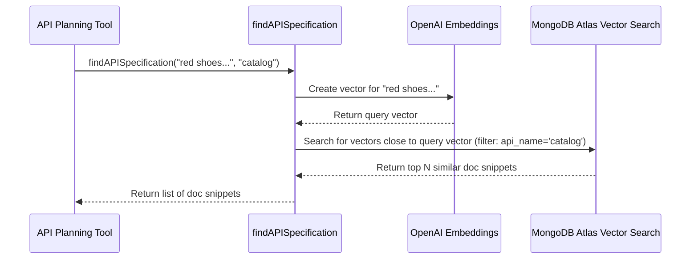

# Chapter 6: Data Retrieval (MongoDB)

In [Chapter 5: OpenAPI Specification Interaction](05_openapi_specification_interaction_.md), we learned how our agent uses the OpenAPI specification as an "instruction manual" to understand how APIs work. But imagine that manual is enormous! When you ask the agent, "Show me red shoes under $50," how does it quickly find the *exact page* in the manual that describes searching for products with color and price filters?

This is where our **Data Retrieval** system comes in. It acts like a super-fast, smart assistant that can find the most relevant snippets of API documentation from a specialized database based on your query. This chapter explains how we use **MongoDB Atlas Vector Search** for this task.

## The Problem: Finding the Right Instructions Quickly

When the agent needs to figure out an API call (as we saw in [Chapter 4: RAG-based API Planning (APITool)](04_rag_based_api_planning__apitool__.md)), it needs the relevant parts of the API documentation (the "manual"). Searching through the entire manual every time would be slow and inefficient.

We need a system that can:
1.  Store the API documentation in small, manageable pieces.
2.  Understand the *meaning* of your query (e.g., "red shoes under $50").
3.  Quickly find the documentation snippets whose meaning is *closest* to your query's meaning.

## Our Solution: MongoDB Atlas Vector Search

To solve this, we use a specific database technology: **MongoDB Atlas Vector Search**. Let's break that down:

*   **MongoDB:** A type of database that's great for storing flexible information, like text documents (our API documentation snippets). It doesn't require a rigid table structure like older databases.
*   **MongoDB Atlas:** A cloud version of MongoDB. This means we don't have to worry about setting up and managing the database servers ourselves – it's handled for us.
*   **Vector Search:** This is the "smart search" part. Instead of just matching keywords, Vector Search understands the *meaning* or *semantic similarity* between texts.

### How Vector Search Works (Analogy)

Imagine a huge library where books aren't organized alphabetically, but by *topic and meaning*. Books about "apples" are near books about "oranges" and "fruit," even if the words are different.

Vector Search does something similar for text:
1.  **Embedding:** Each piece of API documentation (and your query) is converted into a list of numbers called a "vector" or "embedding." This vector represents the text's meaning. Texts with similar meanings get similar vectors. We use AI models (like OpenAI's embedding models) to create these vectors.
2.  **Indexing:** The database stores these vectors in a special way (a vector index) so it can quickly find vectors that are "close" to each other in meaning.
3.  **Searching:** When you ask a query, it's converted into a vector. The database then searches the index for the documentation vectors that are mathematically closest to your query's vector.

This means if you search for "find cheap red sneakers," the vector search can find documentation snippets that mention "search products by price less than" and "filter by color," even though the exact words don't match perfectly.

## Connecting Retrieval to RAG

This retrieval mechanism is the "R" (Retrieval) in the **RAG (Retrieval-Augmented Generation)** process we discussed in [Chapter 4: RAG-based API Planning (APITool)](04_rag_based_api_planning__apitool__.md).

When the `APITool` needs to plan an API call:
1.  It takes your query (e.g., "red shoes under $50").
2.  It uses our MongoDB Vector Search retriever to fetch relevant API documentation snippets.
3.  These snippets are then "Augmented" onto the prompt given to the Language Model (LLM) to help it "Generate" the correct API plan.

## Using the Retriever: Finding API Specs

The core function for this in `shopper-agent` is `findAPISpecification`, located in `src/lib/mongoDBRetriever.ts`. The `APITool` calls this function.

```typescript
// src/lib/mongoDBRetriever.ts (Simplified Call Example)
import { findAPISpecification } from './mongoDBRetriever'

async function exampleUsage() {
  const userQuery = "Show me red shoes under $50";
  const apiArea = "catalog"; // Focus search on 'catalog' API docs

  // Call the function to find relevant docs in MongoDB
  const relevantDocs = await findAPISpecification(userQuery, apiArea);

  // relevantDocs will be a list of documentation snippets, e.g.:
  // [
  //   { pageContent: "GET /products - retrieve list... filter by color, price...", metadata: {...} },
  //   { pageContent: "Filtering: Use 'filter=lt(price, VALUE)'...", metadata: {...} },
  //   ...
  // ]
  console.log(relevantDocs);
}
```
This simplified example shows calling `findAPISpecification` with the user's query and the specific API area (`catalog`). It retrieves a list of document objects, each containing a `pageContent` snippet from the API documentation and some `metadata`.

## Under the Hood: How Retrieval Works Step-by-Step

When `findAPISpecification` is called:

1.  **Connect:** It establishes a connection to the MongoDB Atlas database.
2.  **Embed Query:** It uses an embedding model (like `OpenAIEmbeddings`) to convert your text query ("red shoes under $50") into a numerical vector.
3.  **Vector Search:** It asks MongoDB Atlas to perform a vector search using the query vector. It looks for stored documentation vectors that are most similar. It also applies a filter to only search within docs related to the specified `apiName` (e.g., `catalog`).
4.  **Return Results:** MongoDB returns the top matching documentation snippets.
5.  **Cleanup:** The database connection is closed.

Here’s a diagram illustrating the flow:



## Diving into the Code (Simplified)

Let's look at simplified versions of the key parts in `src/lib/mongoDBRetriever.ts`.

First, setting up the connection and the vector search tool:

```typescript
// src/lib/mongoDBRetriever.ts (Simplified Initialization)
import { MongoDBAtlasVectorSearch } from '@langchain/mongodb';
import { OpenAIEmbeddings } from '@langchain/openai';
import { MongoClient } from 'mongodb';

// Simplified setup part
async function setupVectorSearch(connectionUri: string, dbName: string, collectionName: string) {
  // 1. Create embedding generator
  const embeddings = new OpenAIEmbeddings({ /* ... API key ... */ });

  // 2. Connect to MongoDB Atlas
  const client = new MongoClient(connectionUri);
  await client.connect();
  const collection = client.db(dbName).collection(collectionName);

  // 3. Initialize LangChain's vector search tool
  const vectorStore = new MongoDBAtlasVectorSearch(embeddings, { collection });

  console.log("Connected to MongoDB and Vector Search is ready.");
  return { vectorStore, client }; // Return tool and client for later cleanup
}
```
This code initializes the `OpenAIEmbeddings` component to create vectors and the `MongoDBAtlasVectorSearch` component from LangChain, connecting it to our specific database collection.

Now, the function that performs the search:

```typescript
// src/lib/mongoDBRetriever.ts (Simplified Search Function)
import { Filter } from 'mongodb';

export async function findAPISpecification(question: string, apiName?: string) {
  console.log(`Searching API specs for: "${question}", API: ${apiName}`);
  // Simplified config - normally loaded from environment variables
  const config = {
      mongodbUri: process.env.MONGODB_CONNECTION_URI!,
      dbName: process.env.MONGODB_DATABASE_NAME!,
      collectionName: process.env.MONGODB_API_COLLECTION_NAME!,
  };

  let client; // Variable to hold the client for cleanup
  try {
    // Setup connection and vector store (using simplified function above)
    const setup = await setupVectorSearch(config.mongodbUri, config.dbName, config.collectionName);
    client = setup.client; // Store client reference
    const vectorStore = setup.vectorStore;

    // Define a filter if apiName is provided
    const filter: Filter<any> | undefined = apiName ? { api_name: apiName } : undefined;

    // Perform the similarity search!
    const results = await vectorStore.similaritySearch(
        question, // The user query (gets embedded automatically)
        5,        // Ask for top 5 results
        filter    // Apply the filter (optional)
    );

    console.log(`Found ${results.length} relevant documents.`);
    return results; // Return the found documents

  } catch (error) {
    console.error('Error during MongoDB retrieval:', error);
    throw error; // Handle error
  } finally {
    // Ensure the database connection is closed
    if (client) {
      await client.close();
      console.log("MongoDB connection closed.");
    }
  }
}
```
This function sets up the connection, defines an optional filter based on `apiName`, and then calls `vectorStore.similaritySearch`. This LangChain method automatically handles embedding the `question` and querying the MongoDB vector index, applying the `filter` if provided. Finally, it ensures the database connection is closed.

## Conclusion

We've learned that **Data Retrieval** in `shopper-agent` uses **MongoDB Atlas Vector Search** to act like a smart assistant for finding relevant API documentation snippets. By converting text to **vectors** (embeddings) and searching for semantic **similarity**, it quickly finds the right information needed for the RAG process ([Chapter 4: RAG-based API Planning (APITool)](04_rag_based_api_planning__apitool__.md)). This allows the agent to understand how to interact with APIs even when faced with complex or vaguely worded user requests.

The retrieved documentation helps the agent *plan* the correct API call. But how does the agent actually *execute* that planned call? That's the job of the API Execution Tools.

Let's move on to the final step in the process in [Chapter 7: API Execution Tools](07_api_execution_tools_.md).

---

Generated by [AI Codebase Knowledge Builder](https://github.com/The-Pocket/Tutorial-Codebase-Knowledge)