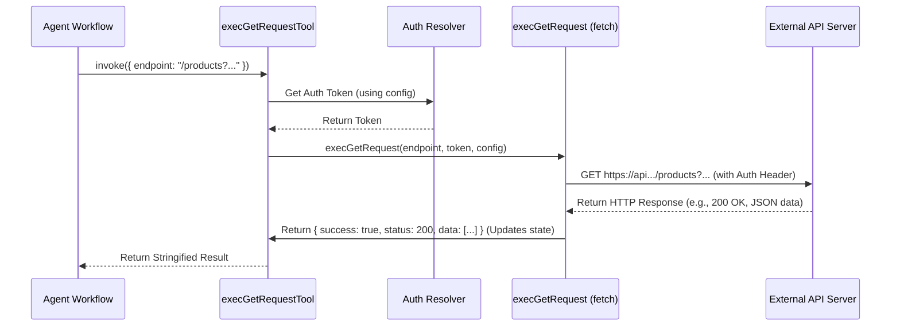

# Chapter 7: API Execution Tools

Welcome to the final chapter of our core tutorial! In [Chapter 6: Data Retrieval (MongoDB)](06_data_retrieval__mongodb_.md), we saw how the agent smartly retrieves the correct API "manual pages" using MongoDB Vector Search. And in [Chapter 4: RAG-based API Planning (APITool)](04_rag_based_api_planning__apitool__.md), we saw how it uses those pages to *plan* the exact API call needed, like figuring out it needs to execute `GET /products?filter=eq(color,red)`.

But planning is one thing; doing is another! The agent has the instructions, but how does it actually *send* that `GET` request over the internet to the Elastic Path server and get the results back? That's the job of the **API Execution Tools**.

Think of the agent's workflow like a chef cooking:
1.  **Planner (APITool):** Writes the recipe step (e.g., "Fetch 2 red apples").
2.  **Execution Tools:** The chef's hands that actually *go to the pantry*, *grab the apples*, and *bring them back*.

These tools are the fundamental bridge between the agent's plan and the real action of communicating with external services.

## What are API Execution Tools?

API Execution Tools are specialized functions within the agent's toolbox ([Chapter 1: Tool Definition & Usage](01_tool_definition___usage_.md)) designed to perform one simple, crucial task: **make a network request to an API**.

They act as the agent's "hands," taking the structured plan generated by tools like `catalogAPITool` and executing it. Here's what they typically do:

1.  **Take Instructions:** They receive the necessary details from the plan, primarily:
    *   The specific **endpoint path** (e.g., `/products`, `/carts/{cartId}/items`).
    *   The **HTTP method** to use (`GET` for fetching, `POST` for creating, `PUT` for updating).
    *   The **request body** (data to send, usually for `POST` or `PUT`).
2.  **Handle Authentication:** They automatically figure out how to add the required API keys or authentication tokens to the request so the API server knows the agent is allowed to make the call. This often involves looking up credentials stored in the agent's configuration or state ([Chapter 3: State Management](03_state_management_.md)).
3.  **Make the Call:** They use standard web technologies (like the `fetch` API in JavaScript) to send the request over the network to the target API server.
4.  **Return the Raw Response:** They capture the server's response (whether it was successful, the data returned, or any errors) and pass it back to the agent's workflow ([Chapter 2: Agent Workflow (LangGraph)](02_agent_workflow__langgraph__.md)) for the next step. They also update the `lastActionSuccess` flag in the state ([Chapter 3: State Management](03_state_management_.md)).

## The `shopper-agent` Execution Tools

In `shopper-agent`, we have specific tools for the most common HTTP methods:

*   `execGetRequestTool`: Used for `GET` requests (retrieving data).
*   `execPostRequestTool`: Used for `POST` requests (creating data, like adding an item to a cart).
*   `execPutRequestTool`: Used for `PUT` requests (updating existing data).

These tools are defined in `src/utils/apiTools.ts` and made available to the agent's workflow.

## Usage Example: Executing a Planned GET Request

Let's revisit our "red shoes under $50" example. Imagine the `catalogAPITool` ([Chapter 4: RAG-based API Planning (APITool)](04_rag_based_api_planning__apitool__.md)) has just returned the following plan:

```
"GET /products?filter=eq(attributes.color,red),lt(attributes.price.USD.amount,5000)"
```
*(Note: Prices are often handled in cents, so $50 might be 5000)*

The agent's workflow ([Chapter 2: Agent Workflow (LangGraph)](02_agent_workflow__langgraph__.md)) now knows it needs to execute this `GET` request. It will select the `execGetRequestTool` and invoke it with the endpoint path:

```typescript
// Conceptual example within the agent's workflow logic:

const plannedEndpoint = "/products?filter=eq(attributes.color,red),lt(attributes.price.USD.amount,5000)";

// The workflow decides to use the execution tool
// (This call happens inside the 'tools' node of the LangGraph)
const result = await execGetRequestTool.invoke({ endpoint: plannedEndpoint });

// 'result' will contain the stringified JSON response from the API, e.g.:
// '{"success":true,"status":200,"data":[{"id":"shoe1",...},{"id":"shoe2",...}]}'
console.log(result);
```

This code snippet simulates the workflow calling the `execGetRequestTool`. The tool takes the `endpoint` string, handles the authentication and network call behind the scenes, and returns the API's response (stringified).

## Internal Implementation: How `execGetRequestTool` Works

What happens when the agent calls `execGetRequestTool`?

1.  **Receive Input:** The tool gets the `endpoint` string (e.g., `/products?filter=...`).
2.  **Get Config:** It accesses the agent's current configuration (passed via the `RunnableConfig` in LangGraph) to find the API base URL (e.g., `https://api.elasticpath.com`) and authentication details (API keys or tokens).
3.  **Resolve Authentication:** It uses a helper function (like `resolveEpRequestParams`) to get the actual, valid authentication token needed for the request. This might involve fetching a new token if the old one expired.
4.  **Construct Full URL:** It combines the base URL and the endpoint path to create the final URL (e.g., `https://api.elasticpath.com/catalog/v2/products?filter=...`).
5.  **Prepare Headers:** It creates the necessary HTTP headers, including the `Authorization: Bearer <token>` header.
6.  **Execute Request:** It calls the core `execGetRequest` function (from `src/lib/execRequests.ts`), which uses the browser's `fetch` API (or Node.js equivalent) to send the `GET` request to the constructed URL with the prepared headers.
7.  **Process Response:** `execGetRequest` waits for the API server's response. It checks if the call was successful (e.g., HTTP status 200 OK). It parses the JSON data from the response.
8.  **Update State:** `execGetRequest` updates the `lastActionSuccess` flag in the agent's state ([Chapter 3: State Management](03_state_management_.md)) to `true` or `false` based on the response status.
9.  **Return Result:** `execGetRequest` bundles the success status, HTTP status code, and the received data into an object. `execGetRequestTool` then stringifies this object and returns it to the agent workflow.

Here’s a simplified diagram of that flow:



## Diving into the Code

Let's look at simplified versions of the key code pieces.

**1. Tool Definition (`src/utils/apiTools.ts`)**

This is where `execGetRequestTool` is defined using LangChain's `tool` function.

```typescript
// src/utils/apiTools.ts (Simplified Snippet)
import { tool } from '@langchain/core/tools'
import { z } from 'zod'
import { execGetRequest } from '../lib/execRequests'
import { resolveEpRequestParams } from './resolve-ep-request-params'
// ... other imports

export const execGetRequestTool = tool(
  // The function that runs when the tool is invoked
  async ({ endpoint }, config) => {
    console.log(`Tool: execGetRequestTool called for endpoint: ${endpoint}`);
    // 1. Resolve authentication and base URL from config
    const options = await resolveEpRequestParams(/* ... using config ... */);

    // 2. Call the actual request execution function
    const results = await execGetRequest({
      endpoint,
      ...options // Pass token, headers, baseUrl
    });

    // 3. Return the stringified result
    return JSON.stringify(results);
  },
  // The tool's definition (name, description, input schema)
  {
    name: 'execGetRequestTool',
    description: 'Execute a GET request to the API',
    schema: z.object({ // Defines the required input
      endpoint: z.string().describe('The API endpoint path and query string')
    })
  }
);
```

This code defines the tool, specifying its name, description, and the input it needs (`endpoint` as a string). The main function logic resolves the necessary authentication options and then calls the `execGetRequest` function to do the heavy lifting.

**2. Request Execution (`src/lib/execRequests.ts`)**

This file contains the functions that perform the actual network calls.

```typescript
// src/lib/execRequests.ts (Simplified Snippet)
import fetch from 'node-fetch'; // Or browser fetch

// Helper to create headers (simplified)
function createHeaders(token?: string, customHeaders?: Record<string, string>) {
  const headers: Record<string, string> = {
    ...(token && { Authorization: `Bearer ${token}` }), // Add auth token
    'Content-Type': 'application/json',
    Accept: 'application/json',
    ...(customHeaders ?? {})
  };
  return headers;
}

// The function performing the GET request
export async function execGetRequest({ endpoint, token, customHeaders, baseUrl }: any) {
  try {
    // Construct the full URL (simplified)
    const url = `${baseUrl}${endpoint}`;
    console.log(`Executing GET request to: ${url}`);

    // Make the network call using fetch
    const response = await fetch(url, {
      method: 'GET',
      headers: createHeaders(token, customHeaders)
    });

    const data = await response.json(); // Parse the JSON response body

    // Update agent state (accessing the global state object)
    if (global.lastShopperState) {
      global.lastShopperState.lastActionSuccess = response.ok; // Set true/false
      console.log(`Updated lastActionSuccess: ${response.ok}`);
    }

    // Bundle the results
    return { success: response.ok, status: response.status, data: data };

  } catch (error) {
    console.error('Error in execGetRequest:', error);
    // Update state on error
    if (global.lastShopperState) { global.lastShopperState.lastActionSuccess = false; }
    return { success: false, error: `${error}` };
  }
}
```

This simplified `execGetRequest` function shows the core steps: building the URL, making the `fetch` call with correct headers (including authentication), parsing the response, updating the `lastActionSuccess` state variable ([Chapter 3: State Management](03_state_management_.md)), and returning a structured result object. Similar functions exist for `POST` (`execPostRequest`) and `PUT` (`execPutRequest`).

## Conclusion

API Execution Tools like `execGetRequestTool`, `execPostRequestTool`, and `execPutRequestTool` are the essential "hands" of our `shopper-agent`. They bridge the gap between planning and action.

We've learned that they:
*   Take precise instructions (endpoint, method, body) from the planning phase ([Chapter 4: RAG-based API Planning (APITool)](04_rag_based_api_planning__apitool__.md)).
*   Handle the complexities of authentication automatically.
*   Perform the actual network communication using standard web technologies.
*   Return the API's response and update the agent's state ([Chapter 3: State Management](03_state_management_.md)) with the success or failure.

With these tools, the agent can reliably interact with external APIs like Elastic Path Commerce Cloud, allowing it to perform useful tasks like searching products, managing carts, and much more, all based on your natural language requests. This completes the core cycle of the agent: understand -> retrieve info -> plan -> execute!

---

Generated by [AI Codebase Knowledge Builder](https://github.com/The-Pocket/Tutorial-Codebase-Knowledge)