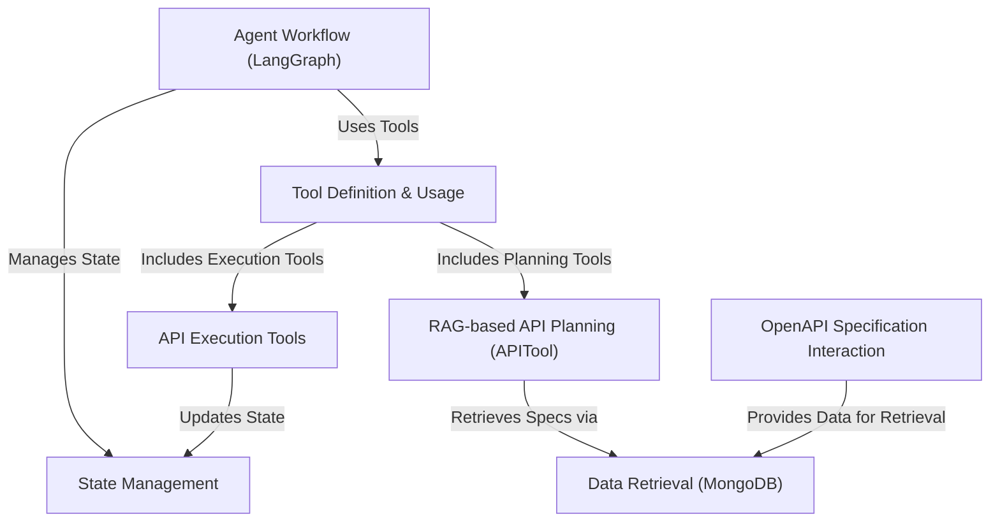

# Tutorial: shopper-agent

This project implements an AI **agent** designed for e-commerce tasks.
It understands *user requests* (like "find red shoes" or "add item to cart"), figures out the correct **API calls** needed to interact with an e-commerce platform (like Elastic Path), executes those calls, and manages the conversation state, including the *shopping cart*.
It uses techniques like RAG (Retrieval-Augmented Generation) to understand API documentation and plan its actions effectively.

**Source Repository:** [None](None)

## Chapters

1. [Tool Definition & Usage
](01_tool_definition___usage_.md)
2. [Agent Workflow (LangGraph)
](02_agent_workflow__langgraph__.md)
3. [State Management
](03_state_management_.md)
4. [RAG-based API Planning (APITool)
](04_rag_based_api_planning__apitool__.md)
5. [OpenAPI Specification Interaction
](05_openapi_specification_interaction_.md)
6. [Data Retrieval (MongoDB)
](06_data_retrieval__mongodb__.md)
7. [API Execution Tools
](07_api_execution_tools_.md)

---

Generated by [AI Codebase Knowledge Builder](https://github.com/The-Pocket/Tutorial-Codebase-Knowledge)